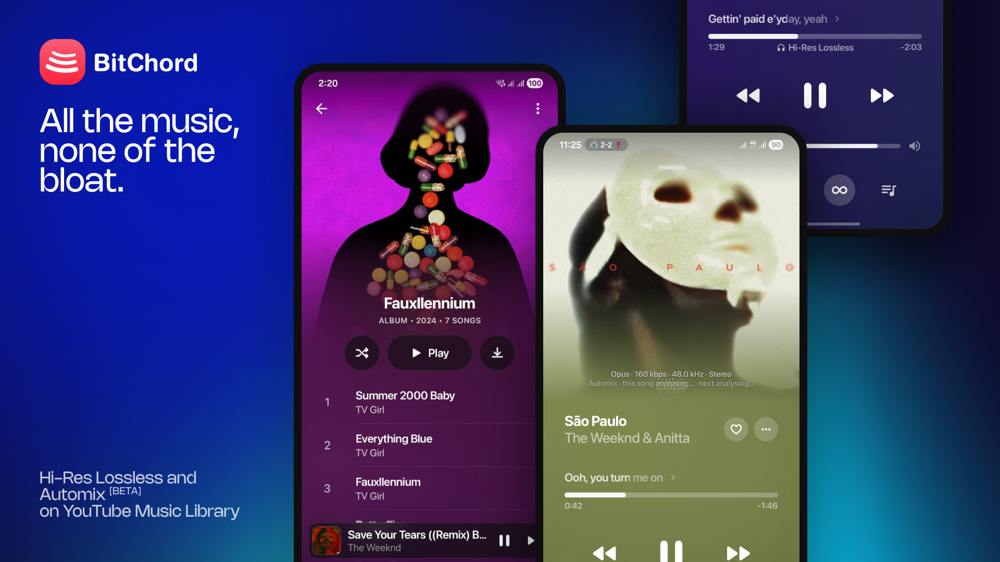

# Auris for iPhone



Auris is an iPhone music client: a SwiftUI interface, shared Kotlin Multiplatform logic, and a Rust audio engine, built on the Apple-platform port of [BitChord](https://github.com/bagumamartin/BitChord) and the [BitChord](https://github.com/kushagrasinghx/BitChord) Android project it descends from.

Derived from [BitChord](https://github.com/kushagrasinghx/BitChord), Copyright © Kushagra Singh and BitChord contributors, licensed under GPLv3. Apple-platform port Copyright © 2026 Martin BAGUMA, also under GPLv3. Auris rebrand and additions Copyright © 2026 OreoMuncher45, also under GPLv3.

Auris is an independent project; it is not affiliated with Google or YouTube.

## Platforms

- **iPhone, iOS 18 or later**
- **Apple Silicon only.** The configured iOS device and iOS Simulator targets are arm64; Intel iOS simulators are not configured.

The project is source-first. An unsigned IPA is produced by the GitHub Actions workflow (`.github/workflows/ios-ipa.yml`); users sign and install it with their own developer identity.

## Install the unsigned IPA

Every release attaches an unsigned IPA named `Auris-<version>-build<build>-ios-unsigned.ipa`. An unsigned build does not install on its own — sign it with your own Apple Developer identity first, then install it.

- Sideload with a tool that re-signs for you (Sideloadly, AltStore, or a signing service): point it at the downloaded IPA and your Apple ID or developer certificate.
- Or sign it yourself in Xcode: open `AppleApp/Auris.xcodeproj`, set your Team on the app and widget targets, connect the iPhone, and run the `Auris` scheme. Register and enable the App Group `group.app.auris.Auris` for both targets.
- A free Apple ID signs for seven days; a paid developer account signs for a year.

Auris is an iPhone app (device family 1) and needs iOS 18 or later.

## Features

The current codebase includes:

- YouTube Music search, browsing, and playback, with optional Google sign-in. Sign-in lets you review the profile before saving; accounts with multiple YouTube channels can switch profiles in Settings.
- Configurable music sources and source modules, local music files, and WebDAV libraries.
- Optional [automatic addon renewal](ADDON_REFRESH.md) using a renewal link supplied by the listener; no addon providers are bundled.
- A native playback engine with downloads, queue management, gapless playback, crossfade, equalizer, and audio-route information.
- Lyrics from multiple providers, including word-synced lyrics where a source supplies them.
- Flow, an endless personal mix: it seeds itself from favourites, listening history and fresh recommendations, and a tuner sets the mood, how much discovery versus memory the mix carries, and which genres to leave out.
- Automix transitions with beat analysis. Optional analysis models can be downloaded in the app; Automix retains a fallback when they are not installed.
- Listen Together, which requires a compatible server address supplied by the listener.
- Widgets, Discord Rich Presence, and Last.fm or ListenBrainz scrobbling.
- Apple-platform audio options, including Dolby Atmos through Apple's renderer for supported source streams, and spatial processing.

Features that depend on external services, sources, audio routes, or optional models may behave differently as those dependencies change.

## Build from source

Builds currently require a Mac with Xcode and the Apple SDKs for the deployment targets above. Install these tools and make them available on `PATH`:

- Xcode, including its command-line tools.
- XcodeGen.
- A JDK supported by the Gradle wrapper.
- Rust with `rustup` and the Apple targets used by the native core.
- CMake, needed by the bundled Opus build.

Clone the repository:

```sh
git clone https://github.com/OreoMuncher45/Auris-iOS.git
cd Auris-iOS
```

The pinned upstream submodule is kept for source comparison and attribution; it is not a build dependency. Initialize it if you want the upstream source locally:

```sh
git submodule update --init --recursive
```

An earlier build installed under a different app identifier remains a separate app; its local data and Keychain session are not migrated. Sign in again in this build, and keep the earlier install if you still need data stored there.

Build the shared framework and native audio framework, generate the Xcode project, and open it:

```sh
rustup target add aarch64-apple-darwin aarch64-apple-ios aarch64-apple-ios-sim
./scripts/build-shared-framework.sh
./scripts/build-native-core.sh
xcodegen generate --spec AppleApp/project.yml
open AppleApp/Auris.xcodeproj
```

In Xcode, select the `Auris` scheme, choose an iPhone or Apple Silicon Simulator destination, then select your Apple Developer Team under the app and widget targets' **Signing & Capabilities**. The Team is per-developer and is not stored in the shared project configuration. For device signing, register and enable the App Group entitlement for both targets with your developer account. The generated frameworks, Swift bindings, and Xcode project are build outputs and are ignored by Git.

To build an unsigned IPA the same way CI does:

```sh
CONFIG=release IOS_SIMULATOR=false ./scripts/build-shared-framework.sh
NATIVE_TARGETS="aarch64-apple-darwin aarch64-apple-ios" ./scripts/build-native-core.sh
xcodegen generate --spec AppleApp/project.yml
./scripts/package-ios-ipa.sh 1.0.4
```

`build-shared-framework.sh` builds the Debug framework by default. For a Release shared framework, run:

```sh
CONFIG=release ./scripts/build-shared-framework.sh
```

The native-core script builds Release frameworks for the configured Apple targets. Run both framework scripts again after changing code in `shared/` or `native-core/`.

### Optional Listen Together server

The app does not ship with a hosted Listen Together service. Enter a compatible server in the app, or set `LISTEN_TOGETHER_SERVER` in the environment or in the root `local.properties` file. With neither configured, the listener supplies a server in the app.

### Optional Automix models

Automix works without downloaded models, using its built-in analysis fallback. The app can offer the beat-analysis model and the larger vocal-analysis model separately. The developer helper `scripts/fetch-automix-models.sh` downloads and verifies both models into `AppleApp/Resources/Models/` for local builds.

## Disclaimer & Legal Notice

Auris is an independent, unofficial third-party music player and client. It is not affiliated with or endorsed by Google LLC, YouTube Music, or the providers of any configured sources.

- **No Media Hosting:** Auris does not operate a hosted music catalog. It plays local libraries and accesses configured sources and third-party services; downloads are stored on the listener's device.
- **Fair Use & API Usage:** Auris is created for personal, research, educational and fair-use purposes. It does not grant rights to music or other content. You are responsible for ensuring your use complies with applicable copyright law and the terms of the services and APIs you choose to access, including YouTube and YouTube Music.
- **No Ad-Blocking Guarantee:** Auris makes no guarantee about the presence, behavior, or availability of advertisements or other platform features. Third-party services can change their access rules and behavior at any time.
- **No warranty and limitation of liability:** For GPLv3-covered portions, the software is provided without warranty and liability is limited as stated in Sections 15 and 16 of [`LICENSE`](LICENSE), except where applicable law requires otherwise or the parties agree in writing. This summary does not replace the license; separately licensed components remain subject to their own terms.
- **Copyleft:** GPLv3 allows redistribution, including for a fee, subject to its terms. Distributors of GPLv3-covered binaries must meet the corresponding-source and notice requirements. Components with additional terms are listed in [`THIRD_PARTY_NOTICES.md`](THIRD_PARTY_NOTICES.md).

## Credits and licenses

Auris descends from the Apple-platform port of [BitChord by Martin Baguma](https://github.com/bagumamartin/BitChord) (Apple-platform port Copyright © 2026 Martin BAGUMA, GPLv3), which in turn descends from [BitChord by Kushagra Singh](https://github.com/kushagrasinghx/BitChord) (Copyright © Kushagra Singh and BitChord contributors, GPLv3). The Android upstream source is pinned as a Git submodule at [`fe198ac`](https://github.com/kushagrasinghx/BitChord/tree/fe198ac); its source, per-file notices, and license are available in `vendor/bitchord-upstream` when the submodule is initialized. See the upstream repository's [maintainers and contributors](https://github.com/kushagrasinghx/BitChord/blob/fe198ac/MAINTAINERS.md) for upstream attribution.

YouTube stream extraction uses [InnerTubeX](https://github.com/MetrolistGroup/innertubex), the maintained resolver used by current Android upstream. Its source is vendored at revision `a6ca8cb76e9c347d4f21824ca9f19b9db2e5aebd` in `vendor/innertubex`, with its GPLv3 license and notices retained. The Apple adapter targets iOS.

Some analyzer code was ported from [Orchard](https://github.com/SFG5453/Orchard), by SFG545, through BitChord's Android implementation. The relevant files identify SFG545 and Kushagra Singh and retain their AGPLv3-or-later terms. The audio clarity contour also credits the [LastWave-native](https://github.com/Clash-Projects/LastWave-native) reference in its source and notices. The upstream README credits [binimum/am-lyrics](https://github.com/binimum/am-lyrics) for the Apple-like lyrics animation; that credit is preserved here.

## License

The project is licensed under the **GNU General Public License v3.0 (GPLv3)**; see [`LICENSE`](LICENSE). Some files and bundled dependencies carry additional or separate terms. Read [`THIRD_PARTY_NOTICES.md`](THIRD_PARTY_NOTICES.md), the license texts in `LICENSES/` and `AppleApp/Resources/AudioLicenses/`, and individual source headers before redistributing or modifying those components. In the app, see **Settings → About → Open-source licenses**.

Binary releases: every GitHub release is built from its tagged commit, and that tag's source archive is the Corresponding Source (GPLv3 §6).
